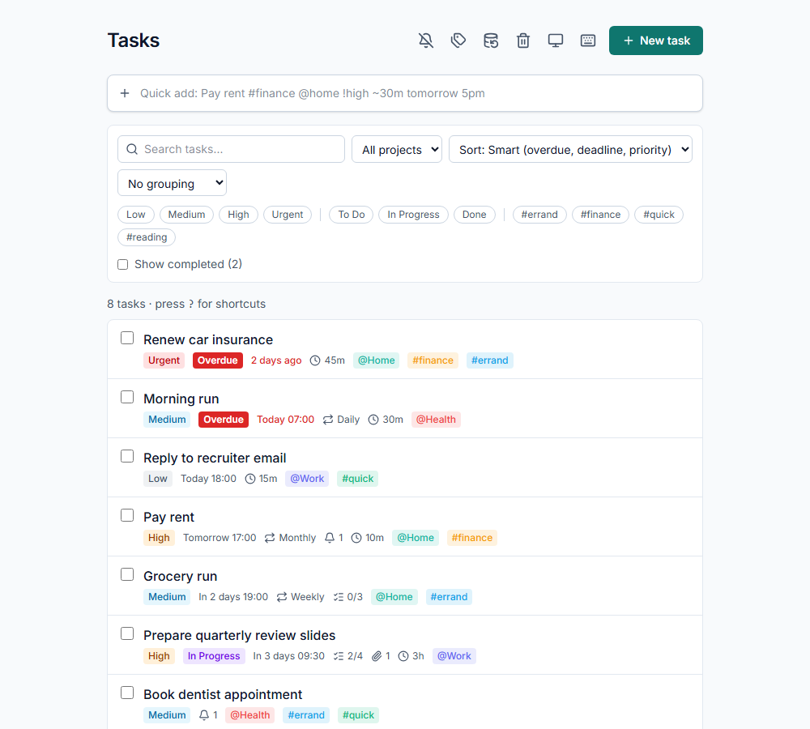
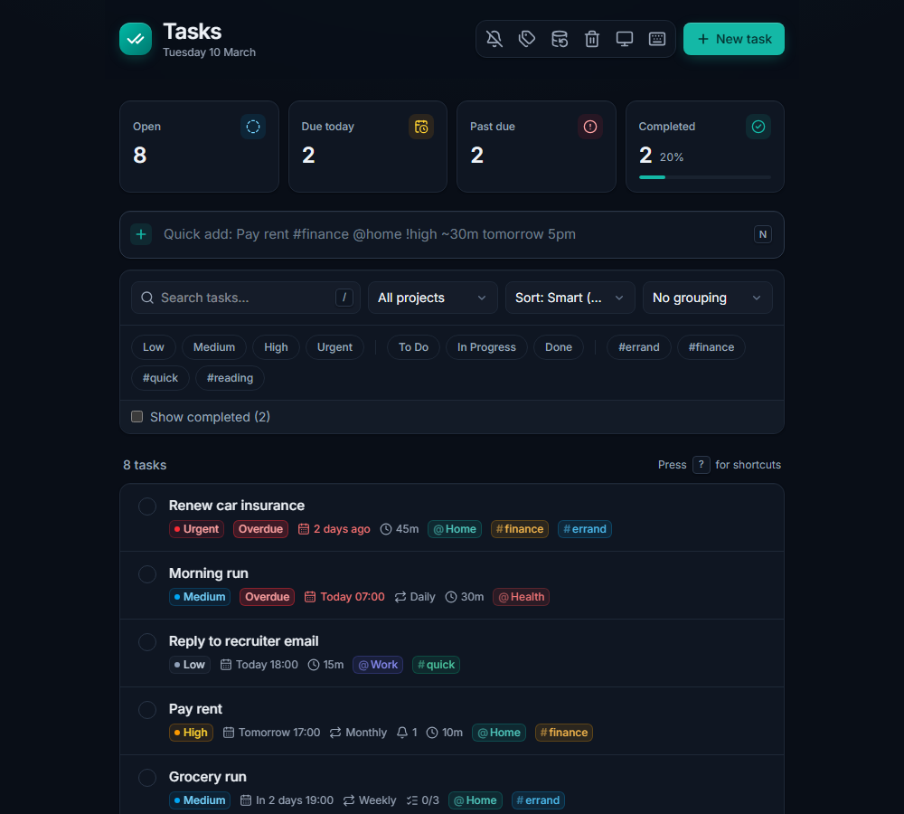
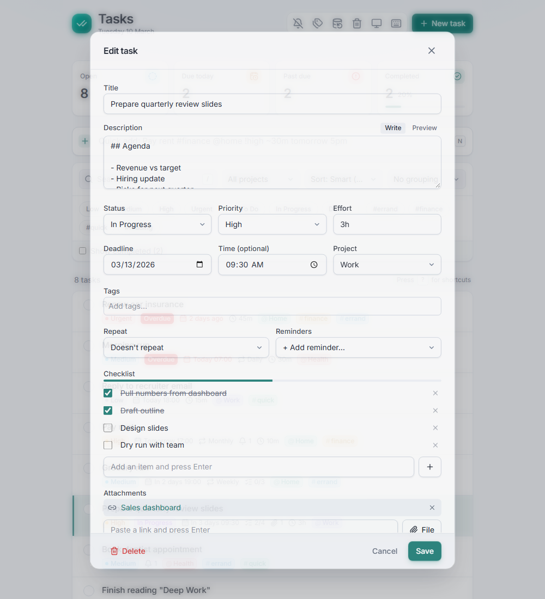
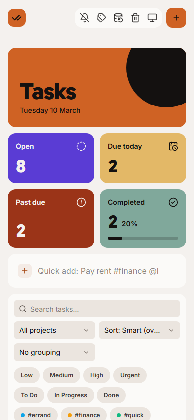

# Task Tracker

[](https://github.com/TengkuAliff94/Task-Tracker/actions/workflows/ci.yml)

**Live demo: [task-tracker-eta-blush.vercel.app](https://task-tracker-eta-blush.vercel.app)**

A personal task tracker that runs entirely in the browser. There's no server and no login: your tasks stay on your device in IndexedDB. It installs as a PWA, works offline and can send reminder notifications.



<p>
  
  
</p>


## Features

- **Quick-add bar**: `Pay rent #finance @home !high ~30m tomorrow 5pm` becomes a task with a tag, a project, a priority, an effort estimate and a deadline. Dates are parsed in plain language with [chrono-node](https://github.com/wanasit/chrono).
- **Smart list**: overdue tasks first, then by deadline, then by priority. You can change the sort, group by project, priority or status, and filter by project, tag, priority or status. Search covers titles, descriptions, tags and checklist items.
- **Rich tasks**: Markdown descriptions, checklists, links and file attachments (up to about 10 MB, stored in IndexedDB), and effort estimates.
- **Time features**: up to 3 reminders per task, at a fixed time or a set time before the deadline. Reminders you missed while the app was closed are listed in a banner. Tasks can repeat daily, weekly, monthly or yearly, or every N days or weeks.
- **Safety nets**: deleting shows an Undo toast, and deleted tasks go to a Trash that empties itself after 30 days. You can back up everything to one JSON file (attachments included), and the app reminds you when it's been a while since your last backup.
- **Keyboard shortcuts**: `N` quick-add, `/` search, `J`/`K` move, `E` edit, `X` toggle done, `?` help.
- **Themes**: light and dark, following the system setting by default. Responsive down to phone widths.

New here? Open the app and click **Load sample data** to see a filled-in list. It is also in the Backup & restore window.

## Tech

React 19 · TypeScript · Vite · Tailwind CSS v4 · Dexie (IndexedDB) · vite-plugin-pwa · Vitest · Playwright

All reads and writes go through the repository modules in `src/db/`, so a backend could replace IndexedDB later without changing the UI. Pure logic (overdue rules, recurrence, the quick-add parser, filters and sorting) lives in `src/lib/` and has unit tests. See [`docs/SPEC.md`](docs/SPEC.md) for the full spec and the decisions made during the build.

## Getting started

```bash
npm install
npm run dev          # http://localhost:5173
```

| Script | What it does |
|---|---|
| `npm run build` | Type-checks and builds to `dist/` |
| `npm run preview` | Serves the production build |
| `npm test` | Unit tests (Vitest) |
| `npm run test:e2e` | End-to-end flows (Playwright; first run `npx playwright install chromium`) |
| `npm run screenshots` | Regenerates the README screenshots from sample data |

### End-to-end tests

The e2e tests live in `e2e/` and use Playwright with Chromium. Before the first run, install the browser:

```bash
npx playwright install chromium   # add --with-deps on a fresh Linux machine
npm run test:e2e
```

`npm run test:e2e` starts the dev server on port 4173 (or reuses one that is already running) and gives each test a fresh browser with empty storage. If a test fails, open the report with `npx playwright show-report`. Test results go to `test-results/` and the report to `playwright-report/`, and git ignores both. New tests should import `test` and `expect` from `e2e/fixtures.ts`. Its `app` fixture opens the app and finds elements by role and label. Vitest only runs `src/**/*.test.ts`, so it skips the e2e files.

## Deploying

The app is a static site. `vercel.json` sets the build and stops the service worker and manifest from being cached, so updates reach installed copies.

The repo is connected to Vercel, so every push to `main` deploys to production and pull requests get preview URLs. To deploy by hand, run `npx vercel --prod`.

## Privacy

Everything stays in your browser's storage on this device. Clearing site data deletes it, so use **Backup & restore** to keep a copy.
